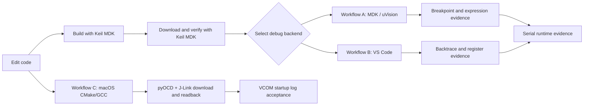

# Command-Line Embedded Debug Workflows A / B / C

[简体中文](README.md) | [English](README.en.md)

This repository is an embedded-debugging knowledge base that can be opened directly as an **Obsidian Vault** while remaining fully compatible with GitHub Markdown.

It preserves two Windows debug workflows and adds an Apple Silicon macOS workflow, with explicit validation boundaries:

- **Workflow A: MDK / uVision debugging**
- **Workflow B: VS Code debugging**
- **Workflow C: macOS + CMake/GCC + J-Link**, with build/download/serial and basic source debugging validated.

Workflow C builds with CMake/GCC, programs through pyOCD and the SEGGER library, and verifies full readback plus VCOM logs. Native SEGGER GDB hardware breakpoints, steps, parameters and function callers passed basic acceptance; FreeRTOS tasks, hardware watchpoints and ordinary IRQ stack capture passed basic acceptance; real HardFault, RTT and tracing remain pending. Fresh VCOM recovery is pending in the stage-one record.

Workflow A stays inside the Keil/uVision ecosystem. Workflow B debugs from VS Code through CMSIS-DAP, pyOCD, and GDB. Both still use Keil MDK for build and verified download; Workflow B is not a separate GCC build.

## Quick navigation

1. [Architecture and backend selection](docs/en/01-architecture.md)
2. [Shared environment setup](docs/en/02-shared-setup.md)
3. [Workflow A: MDK / uVision debugging](docs/en/03-workflow-a-keil-uvsc.md)
4. [Workflow B: VS Code debugging](docs/en/04-workflow-b-cmsis-gdb.md)
5. [Evidence, logs, and troubleshooting](docs/en/05-evidence-and-troubleshooting.md)
6. [AI automation contract and new-machine checklist](docs/en/06-ai-automation-and-checklist.md)
7. [Workflow C: macOS + CMake/GCC + J-Link](docs/en/07-workflow-c-macos-jlink.md)
8. [Workflow C validation: 2026-10-09](docs/en/08-workflow-c-validation-2026-10-09.md)

9. [Workflow C source-debug acceptance: 2026-10-09](docs/en/09-workflow-c-source-debug-2026-10-09.md)
10. [Workflow C stage-one diagnostics](docs/en/10-workflow-c-stage1-2026-10-09.md)
11. [Workflow C: Ozone graphical debug example](docs/en/11-workflow-c-ozone-2026-10-09.md)

## Usage

### Obsidian

Choose **Open folder as vault** and select the repository root.

### GitHub

Follow the navigation above. Every link is standard relative Markdown and requires no Obsidian plugin.

> [!IMPORTANT]
> Use one backend process to manage the CMSIS-DAP or J-Link debug connection, with clients connecting through that backend. Avoid competing debug backends. J-Link SWD and VCOM are separate interfaces and may run concurrently; use only one client per serial port.
