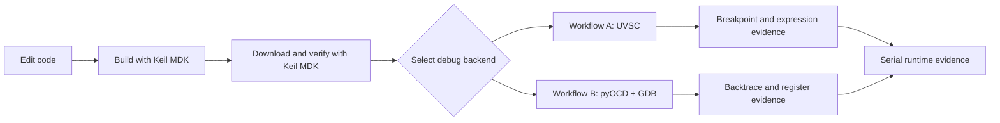

# Two Command-Line Embedded Debug Workflows

[简体中文](README.md) | [English](README.en.md)

This repository is an embedded-debugging knowledge base that can be opened directly as an **Obsidian Vault** while remaining fully compatible with GitHub Markdown.

It documents two reproducible Windows workflows:

- **Workflow A: Keil MDK + UVSC**
- **Workflow B: Keil MDK + CMSIS-DAP + pyOCD + GDB/VS Code**

Both workflows use Keil MDK for build and verified download. Only the debug backend changes.

## Quick navigation

1. [Architecture and backend selection](docs/en/01-architecture.md)
2. [Shared environment setup](docs/en/02-shared-setup.md)
3. [Workflow A: Keil UVSC](docs/en/03-workflow-a-keil-uvsc.md)
4. [Workflow B: CMSIS-DAP + pyOCD/GDB](docs/en/04-workflow-b-cmsis-gdb.md)
5. [Evidence, logs, and troubleshooting](docs/en/05-evidence-and-troubleshooting.md)
6. [AI automation contract and new-machine checklist](docs/en/06-ai-automation-and-checklist.md)

## Usage

### Obsidian

Choose **Open folder as vault** and select the repository root.

### GitHub

Follow the navigation above. Every link is standard relative Markdown and requires no Obsidian plugin.

> [!IMPORTANT]
> Only one process may own a CMSIS-DAP probe at a time. uVision, VS Code, pyOCD, and GDB cannot share one probe connection.

