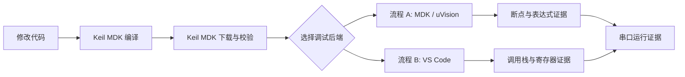

# 两套嵌入式命令行调试流程

[简体中文](README.md) | [English](README.en.md)

这是一套可直接作为 **Obsidian Vault** 打开的嵌入式调试知识库，也完全兼容 GitHub Markdown。

它整理了两条可复现的 Windows 调试链路，名称按用户实际操作入口划分：

- **流程 A：MDK / uVision 调试流程**
- **流程 B：VS Code 调试流程**

流程 A 在 Keil/uVision 体系内完成调试；流程 B 在 VS Code 中通过 CMSIS-DAP、pyOCD 和 GDB 调试。两套流程仍共用 Keil MDK 完成编译和下载，VS Code 流程不是 GCC 重新编译流程。

## 快速导航

1. [架构与选择](docs/zh-CN/01-architecture.md)
2. [公共环境准备](docs/zh-CN/02-shared-setup.md)
3. [流程 A：MDK / uVision 调试](docs/zh-CN/03-workflow-a-keil-uvsc.md)
4. [流程 B：VS Code 调试](docs/zh-CN/04-workflow-b-cmsis-gdb.md)
5. [证据、日志与故障排查](docs/zh-CN/05-evidence-and-troubleshooting.md)
6. [AI 自动化契约与新电脑清单](docs/zh-CN/06-ai-automation-and-checklist.md)

## 使用方式

### Obsidian

选择 **Open folder as vault**，打开本仓库根目录即可。

### GitHub

从本页按导航顺序阅读。所有链接均为标准相对链接，不依赖 Obsidian 插件。

> [!IMPORTANT]
> 任意时刻只能有一个程序占用 CMSIS-DAP。uVision、VS Code、pyOCD 和 GDB 不能同时连接同一个探针。
