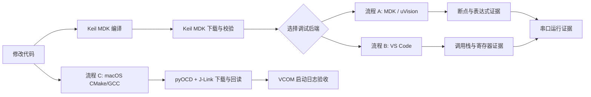

# 嵌入式命令行调试流程 A / B / C

[简体中文](README.md) | [English](README.en.md)

这是一套可直接作为 **Obsidian Vault** 打开的嵌入式调试知识库，也完全兼容 GitHub Markdown。

它保留两条 Windows 调试链路，并新增 Apple Silicon macOS 工作流；各流程分别记录验收范围：

- **流程 A：MDK / uVision 调试流程**
- **流程 B：VS Code 调试流程**
- **流程 C：macOS + CMake/GCC + J-Link**，编译下载、串口和基础源码调试已验证。

流程 C 通过 CMake/GCC 编译、pyOCD 经 SEGGER 库操作 J-Link 下载，再进行全量回读和 VCOM 串口验收。SEGGER 原生 GDB 的硬件断点、单步、参数和函数调用栈已基础验收；FreeRTOS 任务查看、硬件观察点和普通 IRQ 异常栈采集已基础验证；真实 HardFault、RTT 和实时跟踪仍待验证。本轮 VCOM 恢复未通过，见阶段一记录。

流程 A 在 Keil/uVision 体系内完成调试；流程 B 在 VS Code 中通过 CMSIS-DAP、pyOCD 和 GDB 调试。两套流程仍共用 Keil MDK 完成编译和下载，VS Code 流程不是 GCC 重新编译流程。

## 快速导航

1. [架构与选择](docs/zh-CN/01-architecture.md)
2. [公共环境准备](docs/zh-CN/02-shared-setup.md)
3. [流程 A：MDK / uVision 调试](docs/zh-CN/03-workflow-a-keil-uvsc.md)
4. [流程 B：VS Code 调试](docs/zh-CN/04-workflow-b-cmsis-gdb.md)
5. [证据、日志与故障排查](docs/zh-CN/05-evidence-and-troubleshooting.md)
6. [AI 自动化契约与新电脑清单](docs/zh-CN/06-ai-automation-and-checklist.md)
7. [流程 C：macOS + CMake/GCC + J-Link](docs/zh-CN/07-workflow-c-macos-jlink.md)
8. [流程 C 实测记录：2026-10-09](docs/zh-CN/08-workflow-c-validation-2026-10-09.md)

9. [流程 C 源码调试验收：2026-10-09](docs/zh-CN/09-workflow-c-source-debug-2026-10-09.md)
10. [流程 C 阶段一：任务与故障定位](docs/zh-CN/10-workflow-c-stage1-2026-10-09.md)

## 使用方式

### Obsidian

选择 **Open folder as vault**，打开本仓库根目录即可。

### GitHub

从本页按导航顺序阅读。所有链接均为标准相对链接，不依赖 Obsidian 插件。

> [!IMPORTANT]
> CMSIS-DAP 或 J-Link 的调试连接由一个后端进程管理，客户端通过该后端连接，避免多个后端争用探针。J-Link 的 SWD 与 VCOM 是独立接口，可以同时使用；同一串口只能有一个采集工具占用。
