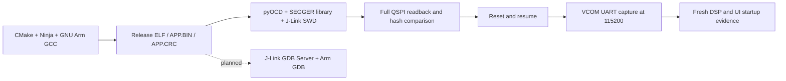

# Workflow C: macOS + CMake/GCC + J-Link

[简体中文](../zh-CN/07-workflow-c-macos-jlink.md) | [English](07-workflow-c-macos-jlink.md) | [Home](../../README.en.md)

**Status: build, verified download, serial evidence and basic source debugging validated; RTOS and tracing pending.**

Validated on 2026-10-09 with Apple Silicon macOS and UDP3900 / STM32H750. This knowledge base describes the reusable workflow; the firmware repository owns build scripts, flash algorithms, linker layout and watchdog handling.

## Actual chain and scope



The validated download uses **pyOCD through the SEGGER library**. Basic native SEGGER GDB Server source debugging is validated. J-Flash and Commander external-QSPI programming remain unvalidated. VCOM is distinct from RTT.

| Capability | Status | Evidence or next acceptance target |
|---|---|---|
| Release build and native checks | Validated | Architecture check and 99 host executable tests |
| QSPI download through pyOCD/J-Link | Validated | Download log and matching full readback |
| Memory, CPU, vectors, ticks and UART settings | Validated | Running CPU, VTOR, advancing ticks, 115200 |
| VCOM startup logs | Validated | DSP 9/9, UI ready, one boot in 45 seconds |
| Source breakpoints, steps, variables and backtrace | Basic acceptance passed | Hardware hits, source step, parameters and real callers; optimized variables and RTOS stack boundary remain limited |
| Watchpoints and HardFault capture | Pending | Actual trigger, registers and exception stack |
| FreeRTOS task inspection | Pending | Native GDB Server plugin acceptance on this firmware |
| RTT | Integration and validation pending | Nonblocking buffers and H7 cache visibility |
| SystemView / SWO | Pending, driven by need | Event instrumentation or trace wiring and clock checks |
| Native SEGGER external-QSPI programming | Pending | Board-specific loader/device configuration and readback |
| COMTool close/reopen reliability | Not fixed | Thread races reproduced; independent capture used for acceptance |

## Repository responsibilities

[UDP3900](https://github.com/houhouoch/UDP_3900_CMAKE) owns `tools/macos/build_cmake.sh`, `flash_cmake_qspi.sh`, `tools/programming/prepare_cmake_qspi.py`, the QSPI FLM and the watchdog script. Use the files in the actual checkout rather than copying a board algorithm into this knowledge base.

UDP3900 is a private repository; its links require GitHub access. Locate the board-owned files through [`build_cmake.sh`](https://github.com/houhouoch/UDP_3900_CMAKE/blob/75f831a4c13a450245cbffcee422353150ac1515/tools/macos/build_cmake.sh), [`flash_cmake_qspi.sh`](https://github.com/houhouoch/UDP_3900_CMAKE/blob/75f831a4c13a450245cbffcee422353150ac1515/tools/macos/flash_cmake_qspi.sh), [`prepare_cmake_qspi.py`](https://github.com/houhouoch/UDP_3900_CMAKE/blob/75f831a4c13a450245cbffcee422353150ac1515/tools/programming/prepare_cmake_qspi.py), [`pyocd_freeze_iwdg.py`](https://github.com/houhouoch/UDP_3900_CMAKE/blob/75f831a4c13a450245cbffcee422353150ac1515/tools/programming/pyocd_freeze_iwdg.py) and [`capture_runtime_probe.py`](https://github.com/houhouoch/UDP_3900_CMAKE/blob/75f831a4c13a450245cbffcee422353150ac1515/tools/macos/capture_runtime_probe.py). These baseline links locate ownership; they do not include every uncommitted change from the test. Use the actual checkout.

The UART change baseline is [`75f831a`](https://github.com/houhouoch/UDP_3900_CMAKE/commit/75f831a4c13a450245cbffcee422353150ac1515). The tested checkout also contained uncommitted UI and tool changes, so that commit alone does not reproduce the accepted image. Identify the image by its hash. See the [validation record](08-workflow-c-validation-2026-10-09.md).

Firmware binaries, vendor installers, probe serial numbers, personal paths and raw device logs remain local.

## Setup and wiring

Requirements: CMake, Ninja, complete GNU Arm tools, Python, pyOCD, pyserial, the target Device Pack and official SEGGER Apple Silicon software. Tested versions: GNU Arm 15.2.1, pyOCD 0.45.1, SEGGER 9.84 and STM32H7 DFP 2.7.0.

SWD requires SWDIO, SWCLK, GND and VTref; nRESET is recommended. Tested at 10 MHz with 3.257 V VTref. Before halt/reset/download on a power instrument, confirm output OFF and List stopped. Do not enable output automatically.

For the standard 20-pin J-Link interface with VCOM enabled and SWD selected:

| J-Link | UDP3900 target |
|---|---|
| Pin 17 DBGRQ / RX | PA15 / UART7_TX |
| Pin 5 TDI / TX | PF6 / UART7_RX |
| GND | Target GND |
| VTref | Target 3.3 V reference |

Verify physical adapter pin numbering and continuity. SWD programming does not prove VCOM is enabled. [Official VCOM guide](https://kb.segger.com/Using_J-Link_VCOM_functionality)

## Command sequence

Copy and source the [macOS environment template](../../templates/environment.macos.sh.example) after replacing placeholders. The commands below are specific to the validated UDP3900 layout: application base **0x90002000**, application area **8376320 bytes**, QSPI window base 0x90000000. These addresses are not interchangeable.

### 1. Preflight

```bash
cd "$FIRMWARE_ROOT"
git status --short
"$SERIAL_PYTHON" -m serial.tools.list_ports -v
DYLD_LIBRARY_PATH="$SEGGER_RUNTIME_DIR" "$PYOCD" json --probes
```

Use the UID and port from current enumeration. Keep `DYLD_LIBRARY_PATH` scoped to each probe command. If pyOCD cannot find J-Link, check the SEGGER library first. Missing serial enumeration is a VCOM question before it is a TX/RX question.

To enable VCOM on a specific probe:

```bash
"$JLINK_EXE" -USB "$JLINK_UID"
```

Enter `vcom enable`, then `exit`, and unplug/replug the J-Link **USB**. Each probe has its own configuration; enabling it normally only needs to be done once. A replacement probe may expose a different port name.

### 2. Checks and build

```bash
python3 tools/macos/check_architecture.py
python3 tools/macos/run_host_tests.py
tools/macos/build_cmake.sh --build-type Release
tools/macos/flash_cmake_qspi.sh --build-type Release --validate-only
mkdir -p "$EVIDENCE_DIR"
cp APP.BIN APP.CRC build/Release/UDP3900.elf "$EVIDENCE_DIR/"
```

`--validate-only` does not program the target. Prevent concurrent builds from overwriting shared APP artifacts. Confirm the generated run description references this ELF; the download command uses that ELF.

### 3. Preserve the existing application

```bash
DYLD_LIBRARY_PATH="$SEGGER_RUNTIME_DIR" "$PYOCD" commander \
  --cbuild-run "$RUN_FILE" --script "$WATCHDOG_SCRIPT" \
  -u "$JLINK_UID" -f 10000000 -M attach \
  -O jlink.power=false -O jlink.device=STM32H750XB \
  -O resume_on_disconnect=false \
  -c "savemem 0x90002000 8376320 $EVIDENCE_DIR/BEFORE.BIN"
```

The run description resolves its Device Pack through `CMSIS_PACK_ROOT`. This application backup excludes Bootloader, other QSPI data and FRAM; it is not a complete device backup. Use a new evidence directory for each run and paths without spaces.

### 4. Download

After confirming the panel is safe:

```bash
DYLD_LIBRARY_PATH="$SEGGER_RUNTIME_DIR" "$PYOCD" load \
  --script "$WATCHDOG_SCRIPT" --cbuild-run "$RUN_FILE" \
  -u "$JLINK_UID" -f 10000000 -M halt -e sector \
  -O jlink.power=false -O jlink.device=STM32H750XB -v
```

This requires the board-specific QSPI algorithm in the run description. The device name alone does not configure external flash. The watchdog hook freezes IWDG while the debugger owns the halted core.

`identical` means programming was skipped because the contents already match. Report that outcome accurately. Reset/halt warnings require actual readback and runtime checks rather than reliance on a zero exit code.

### 5. Capture before resetting

Terminal A:

```bash
"$SERIAL_PYTHON" tools/macos/capture_runtime_probe.py \
  --port "$SERIAL_PORT" --baud 115200 --seconds 45 \
  > "$EVIDENCE_DIR/UART.log" 2>&1
```

Wait until the log contains `[HOST] capture`. Then use Terminal B:

```bash
DYLD_LIBRARY_PATH="$SEGGER_RUNTIME_DIR" "$PYOCD" commander \
  --cbuild-run "$RUN_FILE" --script "$WATCHDOG_SCRIPT" \
  -u "$JLINK_UID" -f 10000000 -M attach \
  -O jlink.power=false -O jlink.device=STM32H750XB \
  -O resume_on_disconnect=false \
  -c 'reset' -c 'go' -c 'status'
```

Capture is read-only with DTR/RTS disabled. Do not share the serial port between COMTool, VS Code and capture scripts. Wait for capture to exit before opening another client.

The application uses **115200 / 8N1 / no flow control**. Bootloader remains at 460800 and may produce initial garbled bytes; it was not updated in this run. J-Link PLUS V12 VCOM supports 115200 in Normal mode and lower rates in Eco modes. [Official specification](https://kb.segger.com/J-Link_PLUS_V12)

### 6. Full readback and runtime acceptance

```bash
IMAGE_SIZE="$(sed -n 's/^SIZE=//p' "$EVIDENCE_DIR/APP.CRC" | tr -d '\r')"
DYLD_LIBRARY_PATH="$SEGGER_RUNTIME_DIR" "$PYOCD" commander \
  --cbuild-run "$RUN_FILE" --script "$WATCHDOG_SCRIPT" \
  -u "$JLINK_UID" -f 10000000 -M attach \
  -O jlink.power=false -O jlink.device=STM32H750XB \
  -O resume_on_disconnect=false \
  -c 'status' -c 'read32 0xe000ed08 4' \
  -c "savemem 0x90002000 $IMAGE_SIZE $EVIDENCE_DIR/READBACK.BIN"
shasum -a 256 "$EVIDENCE_DIR/APP.BIN" "$EVIDENCE_DIR/READBACK.BIN"
lsof "$SERIAL_PORT"
```

Require matching lengths and SHA-256. Expected VTOR is 0x90002000. Combine Running CPU, advancing ticks and fresh serial markers. Resolve tick/UART-handle addresses from the current ELF instead of copying historical RAM addresses. After capture exits, `lsof` must show no lingering serial owner.

## Troubleshooting

- SWD works but no serial node: enable VCOM for the current probe, power-cycle USB and enumerate again.
- Serial node exists but no bytes: check ownership, baud, VTref, ground and crossed wiring; capture before reset. In this test, independent capture recovered after wiring verification and USB replug. The unique cause was not isolated.
- COMTool close/reopen fails: simulated serial tests reproduced two races in 3.4.1—an old receiver closes the new connection, and reconnect opens after manual close. Actual lingering ownership was observed too. No fix has been applied; this does not prove every USB failure is caused by COMTool. Quit and verify release with `lsof`.
- Loopback: disconnect target UART wires first, retain GND/VTref, then short probe pins 5 and 17. Confirm this physical state before sending test data. No echo with the target attached is not a loopback result.
- Reset warnings: this run passed later reset/go, full readback, ticks and serial checks despite RESET pin 15 and halt warnings. The reset wiring issue remains unresolved; do not ignore all such warnings.

## Debugging roadmap

Basic J-Link GDB Server + Arm GDB acceptance passed. See the [source-debug record](09-workflow-c-source-debug-2026-10-09.md) for commands and evidence. The firmware repository now has a separate `ReleaseSymbols` configuration (`-Os -g3`); its machine code matched the full Release readback. Ordinary Release retains `-Os -g0`.

Next validate watchpoints, fault context and FreeRTOS task inspection. Current acceptance covers actual functions and callers, not every task stack. Add RTT, SystemView or SWO when needed, with nonblocking behavior and H7 cache visibility validated. Keep output OFF/List stopped, remove breakpoints, restore the saved freeze register, release backends and verify Release runtime afterwards.

Official references: [GDB Server](https://kb.segger.com/J-Link_GDB_Server), [RTT](https://www.segger.com/products/debug-probes/j-link/technology/about-real-time-transfer/), [SystemView](https://www.segger.com/products/development-tools/systemview/). Vendor capabilities do not imply acceptance on this target.
