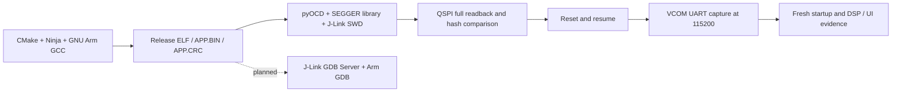

# 流程 C：macOS + CMake/GCC + J-Link

[简体中文](07-workflow-c-macos-jlink.md) | [English](../en/07-workflow-c-macos-jlink.md) | [返回首页](../../README.md)

**状态：编译、下载校验、串口和基础源码调试已验证；RTOS 与实时跟踪待验证。**

2026-10-09 在 Apple Silicon macOS、UDP3900 / STM32H750 上完成端到端验证。这里记录可复用流程；实际构建、QSPI 算法、链接布局和看门狗脚本由目标工程维护。

## 实际工具链与能力边界



本次 J-Link 下载由 **pyOCD 调用 SEGGER 动态库**完成。SEGGER 原生 GDB Server 的基础源码调试已验收；J-Flash 或 J-Link Commander 的外部 QSPI 编程仍未验收。VCOM 日志也不等于 RTT。

| 能力 | 当前状态 | 验收证据或下一步 |
|---|---|---|
| Release 编译和原生检查 | 已验证 | 架构检查、99 项主机可执行测试通过 |
| pyOCD 经 J-Link 下载 QSPI | 已验证 | 镜像校验、下载日志和全量回读一致 |
| 运行状态、向量表、Tick 与 UART 参数读取 | 已验证 | CPU Running、VTOR、Tick 递增、115200 |
| VCOM 串口启动日志 | 已验证 | DSP 9/9、UI ready、45 秒内一次启动 |
| GDB 源码断点、单步、变量、调用栈 | 基础验收通过 | 硬件断点实际命中、源码单步、参数和真实调用者可读；优化变量与 RTOS 栈边界有限制 |
| 数据观察点与异常快照 | 观察点及普通 IRQ 栈已验证 | 快照工具与 11 项解析测试通过；真实 HardFault 尚待验收 |
| FreeRTOS 任务与调用栈 | 基础验收通过 | 9–10 个任务可查看；状态用内核链表核对，任务入口以上回溯有限制 |
| RTT | 待接入和验证 | 固件缓冲区、非阻塞日志、H7 缓存可见性 |
| SystemView / SWO | 按需求推进，未验证 | RTOS 事件接入或 SWO 连线、时钟和采集验证 |
| SEGGER 原生工具编程外部 QSPI | 待验证 | 专用 loader / device 配置和回读 |
| COMTool 关闭后再打开的稳定性 | 未修复 | 已复现线程竞态；当前验收使用独立只读采集 |

## 仓库职责

- 本知识库维护环境、通用命令模板、验证标准与排错经验。
- [UDP3900 工程](https://github.com/houhouoch/UDP_3900_CMAKE)维护 `tools/macos/build_cmake.sh`、`tools/macos/flash_cmake_qspi.sh`、`tools/programming/prepare_cmake_qspi.py`、QSPI FLM 和看门狗脚本。使用对应 checkout 中的真实文件，不把本页当作板级算法的替代品。
- UDP3900 工程为私有仓库，工程链接需要相应 GitHub 访问权限。板级脚本仍以实际 checkout 为准：[`build_cmake.sh`](https://github.com/houhouoch/UDP_3900_CMAKE/blob/75f831a4c13a450245cbffcee422353150ac1515/tools/macos/build_cmake.sh)、[`flash_cmake_qspi.sh`](https://github.com/houhouoch/UDP_3900_CMAKE/blob/75f831a4c13a450245cbffcee422353150ac1515/tools/macos/flash_cmake_qspi.sh)、[`prepare_cmake_qspi.py`](https://github.com/houhouoch/UDP_3900_CMAKE/blob/75f831a4c13a450245cbffcee422353150ac1515/tools/programming/prepare_cmake_qspi.py)、[`pyocd_freeze_iwdg.py`](https://github.com/houhouoch/UDP_3900_CMAKE/blob/75f831a4c13a450245cbffcee422353150ac1515/tools/programming/pyocd_freeze_iwdg.py)、[`capture_runtime_probe.py`](https://github.com/houhouoch/UDP_3900_CMAKE/blob/75f831a4c13a450245cbffcee422353150ac1515/tools/macos/capture_runtime_probe.py)。这些链接用于定位职责，不能保证包含本次所有未提交改动。
- 本次 UART 波特率变更基线为工程提交 [`75f831a`](https://github.com/houhouoch/UDP_3900_CMAKE/commit/75f831a4c13a450245cbffcee422353150ac1515)。验收 checkout 同时含未提交的 UI 和工具改动；这个提交号单独不能重现验收镜像，镜像身份以哈希为准。
- 本仓库不保存固件、商业软件安装包、探针序列号、个人绝对路径或原始设备日志。实测摘要见 [2026-10-09 验收记录](08-workflow-c-validation-2026-10-09.md)。

## 环境与连接

软件：CMake、Ninja、完整 GNU Arm 工具链、Python、pyOCD、pyserial、目标 Device Pack，以及官方 SEGGER Apple Silicon 软件包。本次版本：GNU Arm 15.2.1、pyOCD 0.45.1、SEGGER 9.84、STM32H7 DFP 2.7.0。

SWD：SWDIO、SWCLK、GND、VTref；建议接 nRESET。本次 10 MHz，目标参考电压实测 3.257 V。电源类板子在暂停、复位或烧录前必须确认输出 OFF、List 停止；不会自动开启输出。

标准 J-Link 20 针接口启用 VCOM 并使用 SWD 时：

| J-Link | UDP3900 板端 |
|---|---|
| 17 针 DBGRQ / RX | PA15 / UART7_TX |
| 5 针 TDI / TX | PF6 / UART7_RX |
| GND | 板端 GND |
| VTref | 板端 3.3 V 参考电压 |

丝印描述随接口模式改变；必须检查适配板的实际针号和通断。VCOM 是探针独立配置，SWD 能烧录不代表它已经启用。[SEGGER VCOM 文档](https://kb.segger.com/Using_J-Link_VCOM_functionality)

## 命令行步骤

复制 [macOS 环境模板](../../templates/environment.macos.sh.example)，按实际机器设置变量后在当前终端载入。下面针对 UDP3900 已验证布局：应用起点 **0x90002000**，应用区 **8376320 字节**，QSPI 地址窗口从 0x90000000 开始；不能把整片 QSPI 与应用镜像起点混用。

### 1. 预检和枚举

```bash
cd "$FIRMWARE_ROOT"
git status --short
"$SERIAL_PYTHON" -m serial.tools.list_ports -v
DYLD_LIBRARY_PATH="$SEGGER_RUNTIME_DIR" "$PYOCD" json --probes
```

确认探针 UID 和端口来自本次枚举。`DYLD_LIBRARY_PATH` 只用于相关命令，不永久修改全局环境。pyOCD 找不到 J-Link 时先查 SEGGER 动态库。串口节点不存在时，先查 VCOM，交换 TX/RX 无法生成 USB 串口。

首次启用指定探针的 VCOM：

```bash
"$JLINK_EXE" -USB "$JLINK_UID"
```

在 Commander 输入 `vcom enable`，再输入 `exit`；重新插拔 **J-Link USB**。每只探针分别配置，启用通常只需一次。新探针的端口名称可能不同。

### 2. 检查、编译与镜像校验

```bash
python3 tools/macos/check_architecture.py
python3 tools/macos/run_host_tests.py
tools/macos/build_cmake.sh --build-type Release
tools/macos/flash_cmake_qspi.sh --build-type Release --validate-only
mkdir -p "$EVIDENCE_DIR"
cp APP.BIN APP.CRC build/Release/UDP3900.elf "$EVIDENCE_DIR/"
```

`--validate-only` 只生成/校验镜像与 run description，不连接探针下载。暂停其他构建，避免共享的 `APP.BIN` / `APP.CRC` 被另一种构建覆盖。检查 run description 指向本次 ELF；这里的下载命令使用这个 ELF。

### 3. 烧录前备份

```bash
DYLD_LIBRARY_PATH="$SEGGER_RUNTIME_DIR" "$PYOCD" commander \
  --cbuild-run "$RUN_FILE" --script "$WATCHDOG_SCRIPT" \
  -u "$JLINK_UID" -f 10000000 -M attach \
  -O jlink.power=false -O jlink.device=STM32H750XB \
  -O resume_on_disconnect=false \
  -c "savemem 0x90002000 8376320 $EVIDENCE_DIR/BEFORE.BIN"
```

run description 使用的 Device Pack 路径依赖 `CMSIS_PACK_ROOT`。应用备份不包含 Bootloader、全部 QSPI 数据或 FRAM，不能当作整机备份。路径避免空格，且每次使用新的证据目录，保留备份直至验收结束。

### 4. 下载

确认面板安全状态后：

```bash
DYLD_LIBRARY_PATH="$SEGGER_RUNTIME_DIR" "$PYOCD" load \
  --script "$WATCHDOG_SCRIPT" --cbuild-run "$RUN_FILE" \
  -u "$JLINK_UID" -f 10000000 -M halt -e sector \
  -O jlink.power=false -O jlink.device=STM32H750XB -v
```

这依赖 UDP3900 run description 中配置的外部 QSPI 算法，指定 `STM32H750XB` 本身不会配置自定义板级 QSPI 编程。看门狗脚本仅在调试器控制停核期间冻结 IWDG。

日志中的 `identical` 表示板上内容一致，工具跳过重复擦写。必须如实报告“下载流程校验并跳过”，不能宣称发生了新的写入。若此前发生 RESET / halt 警告，必须检查后续实际运行状态，不能只看返回码。

### 5. 先采集串口，再复位

终端 A：

```bash
"$SERIAL_PYTHON" tools/macos/capture_runtime_probe.py \
  --port "$SERIAL_PORT" --baud 115200 --seconds 45 \
  > "$EVIDENCE_DIR/UART.log" 2>&1
```

先确认日志文件出现 `[HOST] capture`，终端 B 再执行：

```bash
DYLD_LIBRARY_PATH="$SEGGER_RUNTIME_DIR" "$PYOCD" commander \
  --cbuild-run "$RUN_FILE" --script "$WATCHDOG_SCRIPT" \
  -u "$JLINK_UID" -f 10000000 -M attach \
  -O jlink.power=false -O jlink.device=STM32H750XB \
  -O resume_on_disconnect=false \
  -c 'reset' -c 'go' -c 'status'
```

串口采集只读、不发送命令，DTR/RTS 关闭。COMTool、VS Code 串口窗口与采集脚本不能同时占用同一串口。等待采集退出后再打开其他工具。

应用 UART7 为 **115200 / 8N1 / 无流控**。当前 Bootloader 仍是 460800，因此启动最前面可能乱码；本次未修改或下载 Bootloader。J-Link PLUS V12 的 VCOM 正常模式最高 115200，节能模式更低。[官方规格](https://kb.segger.com/J-Link_PLUS_V12)

### 6. 全量回读与运行验收

从本次 `APP.CRC` 的 `SIZE` 取得镜像长度：

```bash
IMAGE_SIZE="$(sed -n 's/^SIZE=//p' "$EVIDENCE_DIR/APP.CRC" | tr -d '\r')"
DYLD_LIBRARY_PATH="$SEGGER_RUNTIME_DIR" "$PYOCD" commander \
  --cbuild-run "$RUN_FILE" --script "$WATCHDOG_SCRIPT" \
  -u "$JLINK_UID" -f 10000000 -M attach \
  -O jlink.power=false -O jlink.device=STM32H750XB \
  -O resume_on_disconnect=false \
  -c 'status' -c 'read32 0xe000ed08 4' \
  -c "savemem 0x90002000 $IMAGE_SIZE $EVIDENCE_DIR/READBACK.BIN"
shasum -a 256 "$EVIDENCE_DIR/APP.BIN" "$EVIDENCE_DIR/READBACK.BIN"
lsof "$SERIAL_PORT"
```

要求两份文件长度与 SHA-256 一致。VTOR 预期 0x90002000；结合 CPU Running、两次 Tick 递增和新的串口启动标志判断运行正常。Tick / UART 句柄地址须由本次 ELF 符号解析，不能沿用历史 RAM 地址。串口采集结束后 `lsof` 不应显示残留占用。

## 排错顺序

1. **SWD 正常、无串口节点**：按探针 UID 启用 VCOM，USB 断电重插，再枚举。
2. **有节点、接收 0 字节**：检查占用、115200、VTref、共地与交叉接线；先开始采集再复位。此次独立采集在 USB 重插前为 0，重插后恢复，但同时核对过接线，未独立证明唯一原因。
3. **COMTool 关闭后打开失效**：COMTool 3.4.1 中已用模拟串口复现旧接收线程关闭新连接、自动重连在手动关闭后重新打开两种竞态；实际串口也出现过 UI 显示关闭但进程仍占用。修复尚未实施，不等于已证明所有 USB 问题都由 COMTool 导致。退出应用后用 `lsof` 确认释放。
4. **回环测试**：只在两根 UART 线已与目标板断开、GND/VTref 保留时，将探针 5 / 17 针短接，然后发送测试字符。确认物理状态后才能发送，接着板子时不能把“无回显”解释成回环失败。
5. **下载警告**：这次出现 RESET pin 15 和停核警告，后续软件复位、全量校验、Tick 与日志验收通过；复位脚问题仍需核对，警告不能一律忽略。

## 后续调试路线

1. J-Link GDB Server + Arm GDB 的基础验收已通过，命令和证据见[源码调试记录](09-workflow-c-source-debug-2026-10-09.md)。
2. 工程新增独立 `ReleaseSymbols` 配置（`-Os -g3`）；本次机器码和 Release 全量回读相同。普通 Release 保持 `-Os -g0`。调试 ELF 必须与板上机器码对应。
3. [阶段一实测](10-workflow-c-stage1-2026-10-09.md)已验证任务查看、硬件观察点和普通 IRQ 异常栈采集。真实 HardFault 与本轮 VCOM 恢复仍待验证。
4. 最后按需求接入 RTT、SystemView 或 SWO。RTT 的非阻塞策略、H7 缓存以及 CPU/探针可见性需要实际验证。
5. 板测保持 OFF、List 停止，结束后删除断点、恢复冻结寄存器、释放后端并验证 Release 运行。

官方参考：[GDB Server](https://kb.segger.com/J-Link_GDB_Server)、[RTT](https://www.segger.com/products/debug-probes/j-link/technology/about-real-time-transfer/)、[SystemView](https://www.segger.com/products/development-tools/systemview/)。文档中的工具能力不代表本工程已经完成验收。
